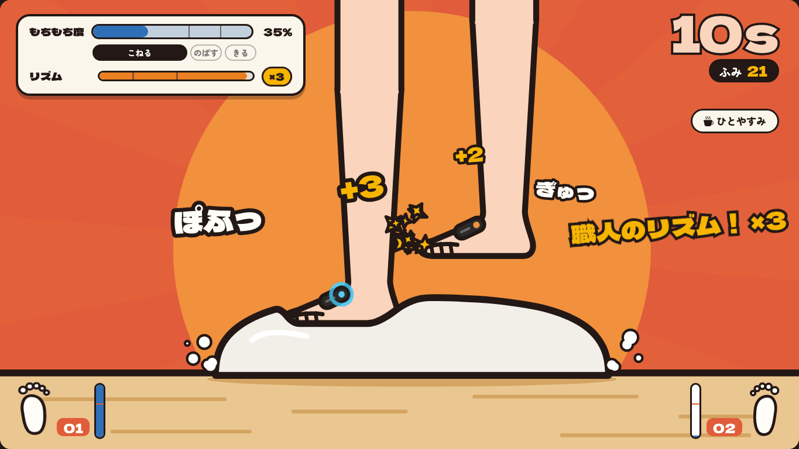

# うどんふみふみ（Udon Kneading Game）

> **Status**: `public` — see [`docs/examples-catalog.md`](https://github.com/Orphe-OSS/ORPHE-CORE.js/blob/main/docs/examples-catalog.md) for the full audit.

ORPHE CORE を足につけて足踏みすると、うどんが **こねる → のばす → きる** の順にできあがっていくゲームです。
**ORPHE INSOLE** でも遊べます。INSOLE では、足うらの 6 つの圧力センサに合わせて、画面の足が生地をふみます（下の「ORPHE INSOLE で遊ぶ」）。
おなじリズムでふみつづけるとコンボで早く進み、ふみかたに応じて 12 種類のうどんができあがります。
足踏みのリズムや左右バランスは、レーダーチャートでふり返れます。



## このexampleで学べること

- 加速度から「足踏み」を検出する方法（重力の除去・包絡線・ヒステリシス・不応期）と、**感度を利用者に合わせて調整する**方法
- 1 ふみごとのログ（時刻・左右・強さ）から、リズム・テンポ・左右バランスなどの指標を作る方法
- センサー処理（純ロジック）と画面を分けて、センサー処理を Node で単体テストする構成
- ORPHE-CORE.js と ORPHE-INSOLE.js を同じページで使う方法と、**最初から圧がかかっている圧力センサ**を校正なしで扱う方法

## 遊び方

1. 画面上の **01**・**02** のスイッチで ORPHE CORE を接続します（01 を左足、02 を右足に。1 台でも遊べます）。
2. **したく** でコース（小盛り 30 ふみ〜特盛 200 ふみ）と **ふみ心地（感度）** を選びます。
   「ためしふみ」でメーターが線をこえれば、その強さで「ふみ」になります。
3. 足踏みすると、生地がこね上がり、麺棒でのび、包丁で切れていきます。時間制限はありません。
   とちゅうで「ひとやすみ」もできます。
   **おなじリズムでふみつづけるとコンボ**になり、1 ふみで進む量が ×1.5 → ×2 → ×3 と増えます（下の「コンボ」）。
4. できあがったうどんと、ふみふみ診断（スコア・レーダーチャート・ログ）を確認します。

CORE がなくても、タイトルの **「CORE なしでおためし」** からキーボード（F = 左、J = 右、スペース = 左右交互）や
画面タップで一通り遊べます。Shift を押しながらだと「そっと」ふみます（感度のちがいを試せます）。

## ORPHE INSOLE で遊ぶ

画面上の切り替えで **INSOLE** をえらび、**01**・**02** のスイッチでつなぎます（1 枚でも遊べます）。
えらんだセンサーは、次に開いたときも覚えています。CORE の接続（CoreToolkit）はそのままで、切り替えるだけです。

- **左右は自動**: INSOLE は自分が左右どちら用かを知っているので（`device_information.mount_position` の bit0）、
  01・02 のどちらでつないでも、左のインソールは左足、右のインソールは右足として扱います。
- **画面の足が、足うらの圧力のとおりに動く**: 「こねる」の間、体重をのせた足は生地にしずみ、足を上げると画面の足も上がります。
  足の下のインソールは つま先・まんなか・かかと の 3 つに分かれていて、圧がかかっているところほど濃く光ります。
  つま先寄り・かかと寄りで、足がすこしかたむきます。
- **足うらマップ**: 画面の左右下と「ためしふみ」に、6 つのセンサの丸がふくらむ足うらの図が出ます。黒い点は圧力の中心です。
- **リザルトの「あしうら」**: つま先・まんなか・かかと、内がわ・外がわのどこに体重がのっていたかを、足ごとに割合で出します。
  CSV には 1 ふみごとの押しぐあい（`press_rel`）と、つま先／かかとのどちらでふんだか（`fore_aft`）の列が加わります。

### 圧力からの「ふみ」の数え方

INSOLE の圧力は ADC の生値で、**足をのせていなくても 1ch あたり 220 前後**（チャネルや個体によって 256 前後）の値が出ています。
くつをはいて立っているだけで、かかとや中足部は最初から数百上がったままです。そこで、値そのものではなく

```text
押しぐあい = いまの値 − そのチャネルの「床」（直近 8 秒の最小値）
```

で見ます（`insole-pressure.js`）。床はチャネルごとに自動で追いかけるので、はじめの校正は要りません。
足を 1 回上げれば、その瞬間に本当の無負荷まで下がります。立ったまま長く動かないと床が上がり、押しっぱなしの表示にはなりません。

- 6ch の押しぐあいの合計が、**谷から十分に立ち上がったら 1 ふみ**。足を床から離さない、体重を左右に移すだけの足踏みも数えます。
- 必要な立ち上がりは、感度（下の表と同じ 5 段階）ごとに「無負荷の合計値に対する割合」で持っています。
  製品版 INSOLE（無負荷の合計 1360 前後）では、およそ 350 / 165 / 90 / 52 / 30 です。
  値の単位がちがう INSOLE 1.5（mV×10、無負荷 590 前後）でも同じ式で動くようにするためです。
- **圧力で数えられている間は、加速度のふみは使いません。** 加速度だけだと、感度によって「足を上げた瞬間」まで数えたり、
  逆に数え落としたりするためです（下の実機ログ）。圧力は着地で 1 回だけ立ち上がります。
- 圧力が反応していない間（センサに足が当たっていない、足を浮かせたままの足踏み、手に持って動かしたとき）は、
  CORE と同じように加速度で数えます。ふみの強さ（G）は、どちらの場合も加速度からとります。

### 調べた実機ログ

ORPHE-INSOLE.js の udon example で 2026-07 に収録した実機ログ（製品版 INSOLE。片足 43 秒と、左右 2 枚 62 秒の 2 回。
`udon-frames-*.csv`）を調べて、数え方としきい値を決めました。

| 見たこと | 値 |
| --- | --- |
| 無負荷の値 | 1ch あたり 219〜223。左は `values[3]`、右は `values[5]` だけ 253〜259 |
| ふんだときの値 | 反応したチャネルで最大 330〜1470（合計の立ち上がりは 150〜2700、ふつうで 800〜1000） |
| 体重ののり方 | かかと（`values[5]`）と中足部（外・`values[4]`）が中心。左の `values[2]` は一度も反応しなかった |
| 通信 | 2 枚同時（200Hz）だと、実際に届いたのは左 115Hz・右 161Hz（パケットの 2〜4 割が落ちる） |
| 加速度だけで数えた場合 | 片足のログの足踏み区間（35 秒・着地 33〜34 回）で、しっかり 16 回／ふつう 43 回／やさしい 49 回 |
| 圧力で数えた場合 | 同じ区間で、どの感度でも 33〜34 回 |

ログ全体を、ゲームと同じ処理（`step-detector.js` ＋ `insole-pressure.js`、感度「ふつう」）に通した結果:

- **片足 43 秒**: 39 ふみ（圧力 34、加速度 5）。加速度の 5 回は、圧力がまったく出ていない最初の 7.5 秒です。
- **左右 2 枚 62 秒**: 76 ふみ（圧力 59、加速度 17）。足踏みが続いている 8〜34 秒は、42 回の着地をすべて圧力で数えました。
  加速度の 17 回は、圧力がほぼ床の値のまま 4.7 秒以上動かなかった区間（35〜41 秒の右、47〜55 秒の両足）です。

圧力が出ていない区間は、インソールに足がのっていない状態で動かしていたと思われますが、ログからは断定できません。
ここは CORE と同じく動きで数える、という決めごとのとおりに動いています。
ログは利用者の計測データなので、リポジトリには入れていません。テストは、上の特徴に合わせた合成データで行っています。

### SDK の読み込み

ORPHE-INSOLE.js は jsDelivr から、リリースタグ（`@v1.4.0`）と SRI ハッシュで固定して読み込みます。
SDK 本体（`OrpheInsole`）は ORPHE-CORE.js と同じページで使えますが、公式の接続 UI（`InsoleToolkit.js`）は
CoreToolkit とグローバル変数（`bles` / `cores`）・DOM の id がぶつかるため、読み込んでいません。
代わりに `insole-connect.js` が、SDK を直接使う小さなスイッチ（自動再接続つき、mode 3 = gyro + acc + press / 200Hz）を持っています。
SDK を読み込めなかったとき（オフラインなど）は INSOLE のスイッチが押せなくなるだけで、CORE とおためしモードはそのまま使えます。

## コンボ（リズムがそろうと早く進む）

コースの大きさ（小盛り 30 など）は「もちもち度」の目標です。1 ふみで 1 進み、リズムがそろうと倍率がかかります。

| おなじリズムが続いた回数 | 1 ふみで進む量 |
| --- | --- |
| 〜2 回 | ×1 |
| 3 回〜 | ×1.5 |
| 7 回〜 | ×2 |
| 14 回〜 | ×3 |

- 「おなじリズム」＝ ふむ間隔が、いつもの間隔（直近 4 回の中央値）の ±25% 以内。テンポの速さは問いません。
  左右で間隔がちがう人（タン・タ、タン・タ）は、ひとつ前の同じ側の間隔とそろっていればつながります。
- 1 回ずれても 1 段階さがるだけで、2 秒以上止まると最初からになります。コンボがなくても進む量は減りません。
- コンボ中は、後ろの丸が明るくなり、ふむ音が少しずつ高くなります。

## 感度（ふみ心地）

従来版は「正規化加速度の連続 2 サンプルの差が 0.06 以上」という衝撃ベースの判定で、±16G レンジでは約 1G の鋭い衝撃が必要でした。
いまは「重力を除いた動きの大きさ」がしきい値をこえたら 1 ふみ、という判定にし、しきい値を選べるようにしています。

| 感度 | しきい値 | めやす |
| --- | --- | --- |
| しっかり | 1.2 G | 元気にふみこむ人向け（従来に近い） |
| ふつう（既定） | 0.6 G | 立って足踏み |
| やさしい | 0.32 G | ゆっくり足踏み |
| とてもやさしい | 0.18 G | いすに座って足踏み |
| ふわふわ | 0.10 G | かかとの上げ下げだけでも |

- **じどうで合わせる**: 6 秒間いつもの強さで足踏みすると、その人の動きからしきい値を決めます。
- **プレイ中のアシスト**: 足は動いているのに 8 秒間「ふみ」にならないと、「感度を上げる」を出します。
  足踏み中は手がふさがっているので、何もしなくても 6 秒後に、届かなかった動きに合わせて自動で上がります
  （「このまま」で断れます。じっと休んでいるだけのときは出ません）。
- スコアは強くふむほど高くなるわけではありません（「ちから」は 6 観点のうちの 1 つで、重みは 10%）。
  やさしくても、そろったリズムでふめば高得点になります。

しきい値は「重力を除いた動きの大きさ（包絡線）」に対する値です。確実に数えられるのは、動きのピークがしきい値のおよそ 1.8 倍以上のときです。

検出のしくみ（`step-detector.js`）:

1. **重力の推定** — 足が止まっている瞬間（接地中）にすばやく合わせ、動いている間はほとんど動かしません。
   動きに引きずられると、ふんだあとに「余韻」が残って次のふみを数えられなくなるためです。
2. **ふみの判定** — 包絡線の「山」と「谷」を追いかけ、しきい値をこえて直前の谷から立ち上がったら 1 ふみ。
   次を数えるには、山から 3 割ほど下がれば足ります。速くバタバタふんで動きの大きさがずっとしきい値より
   上にあっても数えられます（実機で「速くふむと数えられない」不具合があり、この方式にしました）。
   足を上下に動かすと 1 歩のあいだに逆向きの山が 2 つできるので、前のふみと逆向きの山がすぐ来たときは数えません。
   同じ足の不応期は、ゆっくりふんでいるときは 260〜400 ms、速いときは 170 ms まで短くなります。
   反対の足に伝わった振動（直後 140 ms 以内の、ずっと小さい動き）は数えません。
3. **ノイズへの備え** — センサーのノイズが大きいとき、また 8 bit のデータ（CORE 2.0）で 1 目盛りが粗いときは、
   しきい値が自動で持ち上がります。CORE 2.0 でやさしい感度を使うときは、01 / 02 の歯車アイコンから
   加速度レンジを ±2G か ±4G にしてください（±16G では 1 目盛りが 0.126G あり、0.23G 未満の動きは数えられません）。

> しきい値やフィルタの定数は、合成波形でのテスト（`tests/udon-step-detector.test.js`。強さ・幅・テンポ・動きの形・
> 速いバタバタ・50Hz / 200Hz の組み合わせ）で決めた値です。実機では通常の足踏みで動作を確認し、
> そこで見つかった「速くふむと数えられない」不具合を直しましたが、**直したあとの実機確認はまだです。**
> 実際の足踏みで反応が強すぎる・弱すぎる場合は `step-detector.js` の `LEVELS` / `DEFAULTS` を調整してください。

## できあがるうどん（12 種類）

| うどん | こんなふみかたで |
| --- | --- |
| かけうどん | きほんの一杯 |
| きつねうどん | リズムがそろっている |
| 月見うどん | 左右のバランスがよい（CORE 2 台） |
| えび天うどん | 力強くふみこむ |
| 肉うどん | 最後までペースが落ちない |
| カレーうどん | テンポがはやい（およそ 107 ふみ/分〜） |
| ざるうどん | ゆっくり（80 ふみ/分以下）でもリズムがよい |
| わかめうどん | 毎回おなじ強さでふむ |
| たぬきうどん | やさしく、そっとふむ |
| 梅うどん | とちゅうでひとやすみする |
| 力うどん | 大盛り（100）以上のコースをふみきる |
| 鍋焼きうどん | 総合スコアが 85 点以上 |

どれにも良し悪しはなく、ふみかたの個性を映します。まだ出会っていないうどんが少しだけ優先されるので、
遊ぶたびに図鑑が埋まっていきます（`udon-menu.js`）。

## ふみふみ診断（リザルト）

1 ふみごとのログ `{ 時刻, 左右, 強さ[G] }` から、次の 6 観点を 0〜100 点にします（`health-analysis.js`）。

| 観点 | 見ているもの | 重み |
| --- | --- | --- |
| リズム | ふむ間隔のばらつき（変動係数） | 25% |
| テンポ | 1 分あたりのふみ数 | 15% |
| バランス | 左右の回数・強さ・タイミングのつりあい、左右交互にふめたか（CORE 2 台のときだけ） | 20% |
| ちから | ふみこみの強さの中央値 | 10% |
| スタミナ | 前半と後半で、ペースと強さを保てたか | 15% |
| あんてい | ふみこみの強さのばらつき | 15% |

- 2 秒以上（または間隔の中央値の 3 倍以上）あいた間隔は「ひとやすみ」とみなし、リズムやテンポの計算から除きます。
- 「ひとやすみ」ボタンで止めていた時間は時計から除き、再開後の 1 ふみに印をつけて同じように扱います。
- 左右バランスは、両足にふみがあるとき、または片足しかふめていなくても反対の足の CORE が足の上で動いていたときに計測します
  （CORE が 1 台だけ、または 2 台目が置いてあるだけのときは計測しません）。
- 「ふみふみログ」タブでは、テンポの移り変わりと 1 ふみごとの強さ（左は上向き・右は下向き）を確認でき、
  CSV で保存したり、診断とログを 1 枚（A4 横）に印刷したりできます。
- 「きろく」には、この端末（ブラウザの localStorage）にスコアの推移が残ります。サーバーには何も送りません。

> **これは遊びながら体の動きをふり返るための目安で、医療的な診断や評価ではありません。**
> 点数の換算カーブ（`health-analysis.js` の `CURVES`）は経験的に決めた値です。

## 生データのきろく（開発・解析用）

画面上の **●** ボタンを ON にすると（赤くなります）、ふみふみ中にセンサーから届いた値を 1 サンプル 1 行で残し、
**ふみふみが終わったとき（とちゅうでやめたときも）に CSV を自動で保存**します。ON / OFF は次に開いたときも覚えています。
きろくで何か問題が起きても、ふみの判定や画面の進行には影響しないようにしてあります（そのきろくだけをあきらめます）。
既定は OFF です。保存し直したいときは、リザルトの「ふみふみログ」にある **生データを保存** を押します。

- ファイル名: `fumifumi-raw-年月日-時分秒-insole.csv`（CORE のときは `-core.csv`）。ブラウザのダウンロード先に入ります。
- きろくする範囲: カウントダウン（立っているだけの数秒）から、ふみふみの終わりまで。
- 大きさの目安: INSOLE 2 枚（200Hz）で 1 分あたり約 3MB。60 万行（約 25 分）で打ち切ります。
- Chrome は、続けて何度も自動保存すると「複数のファイルのダウンロード」を許可するか聞いてきます。許可してください。
- データはこの端末の中だけで扱います。どこにも送りません。

| 列 | 内容 |
| --- | --- |
| `t_ms` | きろく開始からの時間 [ms]（ブラウザが受け取った時刻。BLE の 1 パケットぶんは同じ値） |
| `screen` / `foot` | `intro`（カウントダウン）・`play`・`pause`・`boil`（終わりの 1 ふみと同じパケットで届いた残り）／ `L`・`R` |
| `ax_g` `ay_g` `az_g` | 加速度 [G] |
| `gx_dps` `gy_dps` `gz_dps` | ジャイロ [deg/s]（きろく用。ふみの判定には使っていません） |
| `p1`〜`p6` | INSOLE の圧力の生値（公式のセンサ番号順。CORE では空） |
| `imu_env_g` `imu_thr_g` | ゲームが見ていた動きの大きさと、そのときのしきい値 [G] |
| `press_sum` `press_floor` `press_thr` `press_load` | 圧力の「床からの上がり幅」の合計、無負荷とみなしている合計値、1 ふみに必要な立ち上がり、画面の足の押しぐあい（0〜1） |
| `serial` `pkt` `sensor_ms` | SDK が付けたパケット連番・パケット内の順番・センサー側の時刻（通信の欠けを調べる用） |
| `event` | `step:press` / `step:imu`（数えたふみ）、`imu:ignored`（圧力で数えているので見送った加速度のふみ）、`press:merged`、`detect:…`（カウントダウン中に見つけたふみ）、目印の行（`start` / `play` / `phase:roll` / `pause:manual` / `resume` / `end:finish` など） |
| `count` `mult` | ふみを数えた行だけ: その時点のふみ数と、コンボの倍率 |

ファイルの先頭には `# 名前: 値` の行で、つかったセンサー・感度・コース・つないだ機器のようす（電池、左右、実測 Hz、
落ちたパケット数）・行数などが入ります（pandas なら `read_csv(path, comment='#')` で読み飛ばせます）。

## 使うデータ

- ORPHE CORE: 加速度 (`gotConvertedAcc`, 実 G スケール)。通知タイプは `SENSOR_VALUES`
- ORPHE INSOLE: 加速度 (`gotConvertedAcc`) と 6ch の圧力 (`gotPress`)。ストリーミングモード 3
- どちらも、ジャイロ (`gotConvertedGyro`) は生データのきろくにだけ使います

## 必要なORPHE CORE数

- ORPHE CORE 1〜2 台、または ORPHE INSOLE 1〜2 枚（2 つだと左右バランスも計測できます）

## ファイル構成

| ファイル | 役割 |
| --- | --- |
| `index.html` / `styles.css` | 画面。ステージ内は幅に比例して拡大縮小します |
| `scripts.js` | CORE の接続（CoreToolkit。従来のまま）と、センサー値をゲームへ渡す橋渡し |
| `insole-connect.js` | INSOLE の接続（SDK を直接使うスイッチ・左右の割り当て）と、加速度・圧力をゲームへ渡す橋渡し |
| `step-detector.js` | 足踏みの検出と感度（純ロジック） |
| `insole-pressure.js` | INSOLE の圧力 → ふみ・押しぐあい・圧力の中心・足うらの集計、加速度のふみとのまとめ方（純ロジック） |
| `raw-recorder.js` | 生データのきろく（1 サンプル 1 行の CSV。純ロジック） |
| `health-analysis.js` | ふみふみログの解析・スコア・CSV（純ロジック） |
| `udon-menu.js` | うどん 12 種と出し分け（純ロジック） |
| `combo.js` | リズムのコンボの規則（純ロジック） |
| `udon-art.js` | イラスト（SVG）。元の `udon.png` / `asi.png` のタッチを描き起こしたもの |
| `charts.js` | レーダーチャート・ログのグラフ（SVG） |
| `audio.js` | 音。元の音源（`puni.wav` / `pipi.wav` / `soundA.mp3` / `soundB.mp3`）＋合成音 |
| `game.js` | 進行・キャンバス描画・リザルト・図鑑・きろく |

`asi.png` と `setumei.png` は従来版のイラストです（現在の画面では使っていませんが、原画として残しています）。
`udon.png` はページのアイコンに使っています。

## テスト

```bash
node tests/udon-step-detector.test.js     # 検出器: 感度・静止ノイズ・量子化・クロストーク・50Hz/200Hz
node tests/udon-health-analysis.test.js   # 解析とうどんの出し分け
node tests/udon-combo.test.js             # コンボの規則
node tests/udon-core-bridge.test.js       # CORE → ゲームの橋渡し、index.html との整合
node tests/udon-insole-pressure.test.js   # INSOLE の圧力: 最初からの圧・感度・単位のちがい・飛び値・パケット落ち・加速度とのまとめ方
node tests/udon-insole-bridge.test.js     # INSOLE → ゲームの橋渡し、左右の割り当て、切断と再接続、SDK の読み込み方
node tests/udon-raw-recorder.test.js      # 生データのきろく: 列がずれない・欠けた値は空・読み戻すと元の値・行数の上限
```

いずれも `npm test` に含まれます。

### 見た目の確認用 URL パラメータ（開発者向け）

`index.html?screen=result&seed` のように付けると、途中の画面から始められます。

- `screen=setup|intro|play|finish|result|zukan|history`、`p=0.7`（play の進み具合）、`auto=1`（自動でふむ）
- `course=komori|nami|oomori|tokumori`、`feet=1`、`style=gentle|ragged|rest`、`udon=<id>`、`seed`（図鑑ときろくにダミーデータ）
- `device=insole`（ORPHE INSOLE の見た目で。おためしモードでは足うらの圧力も合成します）
- `record`（生データのきろくを ON にして開く。設定には保存しません）

## 想定読者

- ゲームプレイヤー・クリエイティブコーダー
- 体操や介護予防のレクリエーションで、足踏みをたのしく続けたい方・その支援者

## 実機確認

- **複数人で実機プレイ済み** — 2026-11-13 に、オーナーのもとで何人かが実機で通しプレイ（生データのきろくは OFF だったため、数え方をデータでは確かめていません）。
  下の未確認項目は、マージ後の実機テストで確かめる予定です。
- **一部確認済み** — オーナーが実機（CORE 2 台）で通しプレイを確認（2026-11-12）。そのとき見つかった
  「速くバタバタふむと数えられない」は検出器を直して合成波形のテストを追加しましたが、修正後の実機確認はまだです。
  やさしい感度（とてもやさしい・ふわふわ）での実際の足踏み、CORE 2.0（8 bit）での動作も未確認です。
- **ORPHE INSOLE も一部確認済み** — オーナーが実機の INSOLE で通しプレイを確認（2026-11-13、特に不満なし）。
  このときは生データをきろくしていなかったため、数え方が合っていたかをデータでは確かめていません。
  左右の自動判定、自動再接続、INSOLE 1.5（INS2。値が mV×10 で届く）を個別に確かめたかどうかは分かっていません。
- **生データのきろくは実機で未確認** — 2026-07 の実機ログをページに流してきろくし、保存された CSV が流した値と
  1 行ずつ一致すること（6912 行）と、CORE の経路をまねたデータで 1 サンプル 1 行になることを確かめました。

## 関連example

- [`examples/drum_test/`](../drum_test/README.md) — Drum Game
