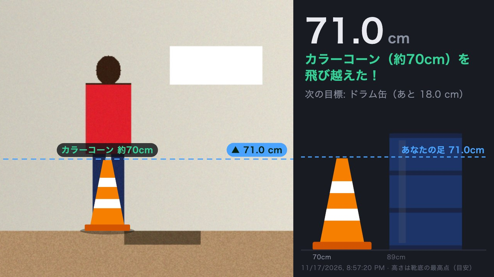

# Jump Over

> **Status**: `needs-review`（カタログ上は `hidden`）— 実機での確認後に公開ナビゲーションへ載せる予定です。

ORPHE CORE を足に着けて跳ぶと、センサーデータから**靴底がどこまで上がったか**を推定し、
カメラ映像の最高点の瞬間に「カラーコーン（約70cm）を飛び越えた！」のように**身近なもののイラストを実寸比で合成**して記録します。

## このexampleで学べること

- `SENSOR_VALUES`（200 Hz）の加速度とクォータニオンから、踏み切り・着地を検出してジャンプの高さを推定する方法
- クォータニオンで加速度をワールド座標に回転し、重力方向に射影して二重積分する（離地・着地の高さ = 0 の拘束でドリフトを除去）
- センサー時刻（シリアル番号）とカメラ映像の時刻を対応付けて、最高点のコマを取り出す方法
- CoreToolkit を使った接続 UI と、アプリ独自の UI（カメラ・録画・全画面）の組み合わせ方

## 使い方

1. 「カメラ開始」→ 上部の CoreToolkit のスイッチで ORPHE CORE に接続（加速度 ±16 G / ジャイロ ±2000 dps）
2. 「自動校正」: 身長を入力（初回のみ）→ 誰も映っていない状態で背景を記録 → 跳ぶ場所に立って静止すると、
   地面の線と基準の高さ（身長）の線が自動で合います。手動でドラッグして調整することもできます。
3. 1 秒ほど静止してからジャンプ。最高点の写真と、飛び越えたもの・次の目標が表示されます。
4. 「録画」を停止すると、生データ CSV・動画・ジャンプ一覧（動画内の最高点の時刻つき）・記録画像・校正情報を zip で保存します。
   動画から教師データを作り、推定式を補正し直すのに使えます。
5. 映像右上のアイコンで全画面表示（右側に記録画像、クリックで拡大）。

## 推定方法（`jump.js`）

1. 踏み切り: |加速度| > 6 G
2. 着地: 踏み切りから 0.25 s 以降で |加速度| > 10 G（空中でも足の振りで ~6 G 出るため別のしきい値）
3. 踏み切り前の静止区間で重力方向を求め、ワールド座標の加速度を射影して二重積分 → 足の最高点
4. 動画から作った教師データ（靴底の最高点）9 本で線形補正: `cm = 0.8628 × raw + 5.0192`

精度（教師データ 9 本・1 本抜き交差検証）: 平均絶対誤差 約 2.5 cm。表示値は**靴底の最高点**で、重心の上昇量（滞空時間から求める跳躍高）とは異なります。
CORE 2.0（約 50 Hz、シリアル番号なし）は受信数 × 20 ms で時刻を補って動作しますが、補正係数は CORE 3.0 のデータで求めたものです。

## 使うデータ

- 加速度 (gotConvertedAcc, 実Gスケール)
- クォータニオン (quat)
- ジャイロ (converted_gyro, 録画用)

## 必要なORPHE CORE数

- 1 台（片足の甲に装着）

## 想定読者

- 研究者・解析者、スポーツ計測、ワークショップ

## 実機確認

- 記録済みの生データ（CORE 3.0 / CORE 2.0）とカメラ映像の再生では確認済み。
- **未実機確認** — この example（CoreToolkit 版）での BLE 接続後の挙動は実機での確認待ち。

## ファイル

| ファイル | 内容 |
| --- | --- |
| `index.html` | 画面・カメラ・自動校正・録画・全画面 |
| `jump.js` | ジャンプ検出と高さ推定（`JumpDetector`）、センサー時刻（`SerialClock`） |
| `objects.js` | 比べる身近なもののイラスト（SVG）と高さ |

## 関連

- 開発元リポジトリ（解析用スクリプト・CSV 解析ページ）: https://github.com/shiratsumu/orphe-jump-over
